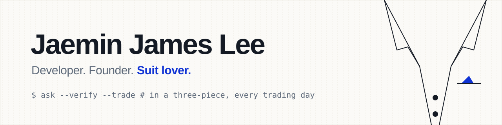

<p align="center"></p>

### Hey, I'm Jaemin 👋

```python
class Jaemin:
    role       = "Founder, CEO & CTO @ Quantus"
    location   = "Seoul, Korea"
    stack      = ["Claude Code", "Codex", "pure vibes"]  # super vibe coder
    dress_code = "three piece suit. yes, even while debugging."

    def currently(self):
        return "teaching an AI agent to place real orders, safely"

    def debug(self):
        return "tie loosened, never removed"
```

- 🏦 Building **[Quantus](https://www.quantus.kr)**: say a trading rule in plain words, check it against price data back to 1964, then run it in *your own* brokerage account. 33 months live, USD 821M executed so far.
- 🤖 Working on **Q**, the AI agent on top of it (beta).
- 👔 Fun fact: I code in a suit. Real money runs on this code, so I dress for it.
- 🧵 Rules I stole from my tailor:
  - *measure twice, cut once* → backtest before the first order goes out
  - *no loose threads* → duplicate-order guards, audit logs, a kill switch
  - *fit over fashion* → boring tools that work
- 🎓 Before this: sequence-data AI at Riiid, Nexon and Kakao Style, then quant work. PhD candidate at Sungkyunkwan University.

#### 🛠 Things I open-sourced

- [**sumbi**](https://github.com/Jaeminyx-Stoa/sumbi): a self-improving harness for coding agents. Measures friction, keeps what works.
- [**pydbsec**](https://github.com/Jaeminyx-Stoa/pydbsec) · [**pykiwoom**](https://github.com/Jaeminyx-Stoa/pykiwoom): Python wrappers for Korean broker APIs (DB Securities, Kiwoom)

#### 📫 Say hi

[quantus.kr](https://www.quantus.kr) · [LinkedIn](https://www.linkedin.com/in/jaemin-james-lee-98769b130/)
